<picture>
  <source media="(prefers-color-scheme: dark)" srcset="assets/hero-dark.svg">
  
</picture>

I'm a Computer Science student at the Jerusalem College of Technology (JCT), with a high-school background in computers and electronics. I like working close to the machine — C, Linux, an assembler written from scratch — and I also like shipping complete products that people actually use. I led my team to first place in one hackathon and took second place in another, run by the Moshal Program, which I'm part of.

### Selected work

  <picture><source media="(prefers-color-scheme: dark)" srcset="assets/card-remind-dark.svg"></picture>
  <a href="https://github.com/i-sh-sh/Moshal_Hackathon_26"><picture><source media="(prefers-color-scheme: dark)" srcset="assets/card-teamsprintup-dark.svg"></picture></a>

  <picture><source media="(prefers-color-scheme: dark)" srcset="assets/card-assembler-dark.svg"></picture>
  <a href="https://github.com/i-sh-sh/casa"><picture><source media="(prefers-color-scheme: dark)" srcset="assets/card-casa-dark.svg"></picture></a>

  <a href="https://github.com/i-sh-sh/rentradar"><picture><source media="(prefers-color-scheme: dark)" srcset="assets/card-rentradar-dark.svg"></picture></a>
  <a href="https://github.com/i-sh-sh/SocialQuest"><picture><source media="(prefers-color-scheme: dark)" srcset="assets/card-socialquest-dark.svg"></picture></a>

Also: [**design-skills**](https://github.com/i-sh-sh/design-skills) — a Claude Code plugin with design skills that learn their owner's taste from project to project.

### Stack

<picture>
  <source media="(prefers-color-scheme: dark)" srcset="assets/stack-dark.svg">
  
</picture>

### Contact

[LinkedIn](https://linkedin.com/in/israel-s-02a3bb228) · [shshteinberg@gmail.com](mailto:shshteinberg@gmail.com) · Hebrew, English, Russian

Assets are generated by <code>scripts/build_assets.py</code>. Animations play once and respect reduced-motion settings.
